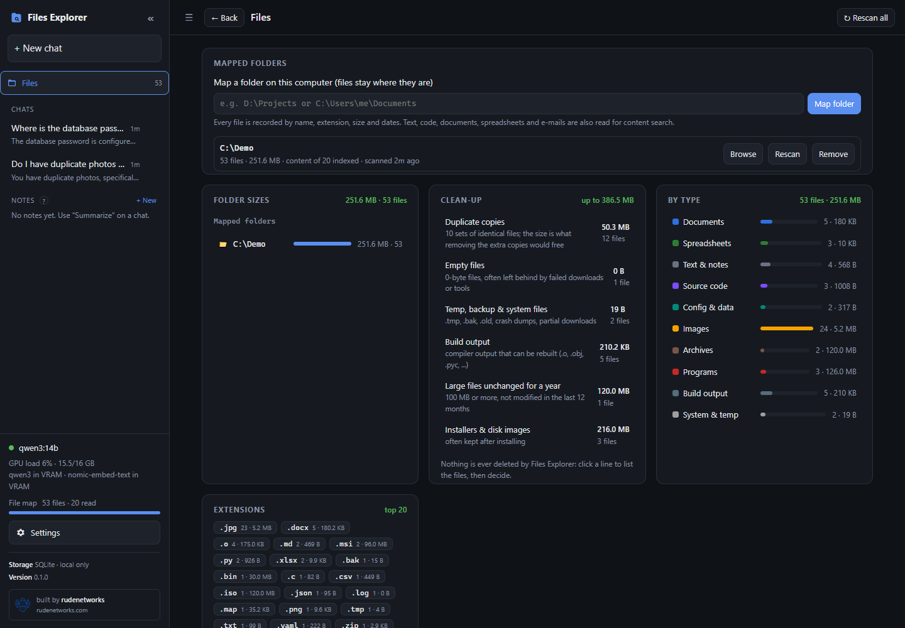
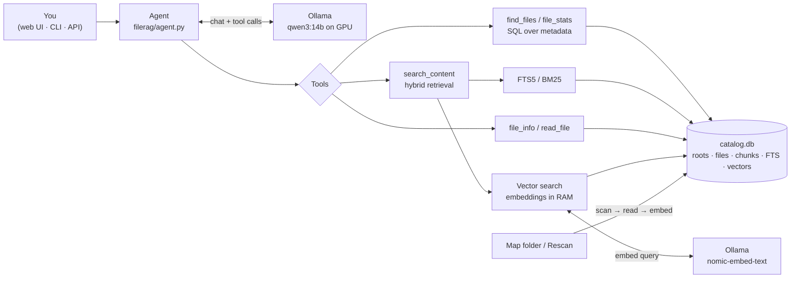
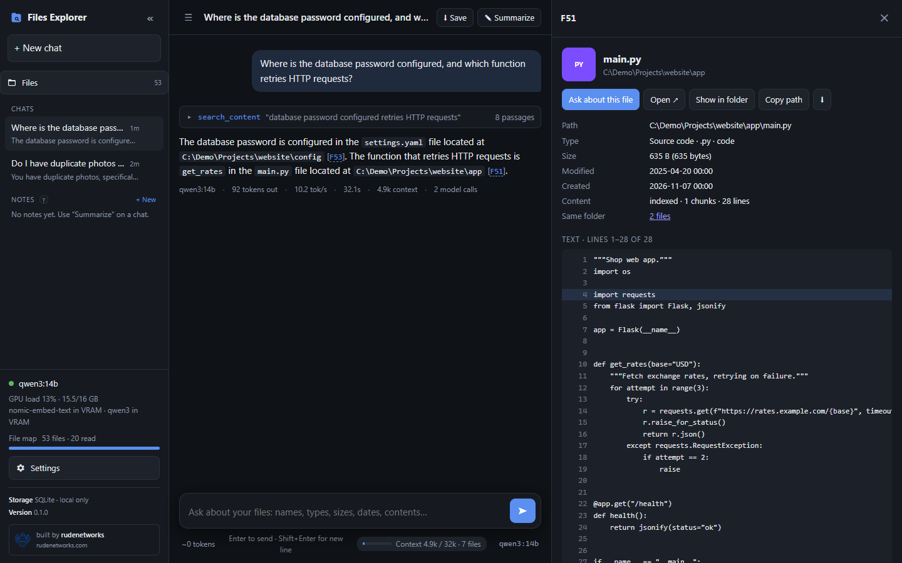
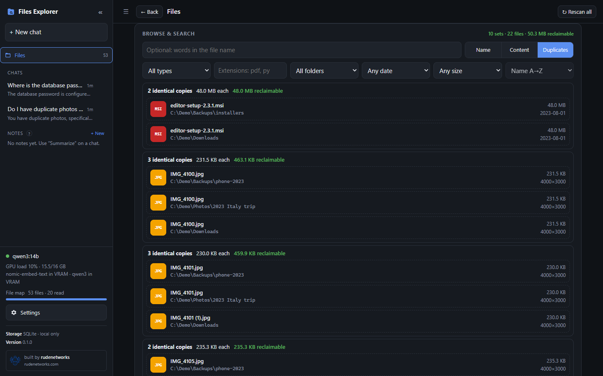

<div align="center">


# Files Explorer

**A fully local AI map of your files: find anything by name, extension, size, date or what is written inside it. Your files, your GPU, nothing leaves the machine.**


-black)

Built by **[rudenetworks](https://rudenetworks.com)** · same design as CVE Explorer and Document Explorer

[Installation](docs/installation.md) · [User guide](docs/user-guide.md) · [CLI](docs/cli.md) · [API](docs/api.md) ·
[Configuration](docs/configuration.md) · [Architecture](docs/architecture.md) · [FAQ](docs/troubleshooting.md)

</div>



Files Explorer maps folders on your computer into a local catalog and lets you search it, browse it, or ask a
chat agent about it in plain language (*"where are my 2024 invoices?"*, *"the 10 largest videos"*, *"which config
file sets the database password?"*, *"what kinds of files take the most space in Projects?"*). Every file is
mapped by name, extension, category, size and dates; the text of readable files (documents, code, notes,
spreadsheets, e-mails) is indexed for content search. A local LLM in [Ollama](https://ollama.com) answers with
clickable file citations like `[F12]` or `[F12 L40]` (line 40).

---

## Features

**Mapping**
- Map any number of folders; files stay where they are. Scans are **incremental**: unchanged files (same size
  and modification time) are never read again, deleted files drop out, **Rescan** picks up changes.
- Background phases, so results show up early: **scan** (every file's metadata, thousands per second),
  **quick** + **hash** (duplicate candidates), **media** (image details), **content** (text of readable files, chunked and
  full-text indexed), **embed** (semantic vectors on the GPU).
- 17 **categories** by extension (documents, spreadsheets, code, config, images, audio, video, archives,
  programs, databases, fonts, 3D/design, …) plus per-extension statistics.
- Content formats: `.pdf` `.docx` `.pptx` `.xlsx` `.csv` `.html` `.eml` `.json` `.ipynb` `.md` and ~150 text, code
  and config extensions; files with an unknown extension are read when their bytes look like text. Code and text
  keep **exact line numbers**.
- **Duplicates**: only files that share their size with another file can be identical. Files over 1 MB first get
  a quick check (first and last 64 KB); only those that still match another file are hashed in full (SHA-256),
  so all identical copies are found while reading only a fraction of the disk. Identical files are read and
  embedded once.
- **Images**: pixel size, EXIF date taken and camera (search "photos from 2023", "images over 4000 px").
- **Archives**: the names of the files inside `.zip` `.jar` `.whl` `.apk` `.epub` and `.tar(.gz/.bz2/.xz)` are
  listed and searchable ("which zip contains setup.py?").
- Skips `.git`, `node_modules`, virtual envs, hidden and system folders (configurable).

**Search**
- **Files page**: folder list with live progress, breakdown by type and extension (click to filter), and a
  browser with **Name** search (words or globs like `*.tar.gz`) or **Content** search, filters for type,
  extension, folder, date and size, and sorting.
- **Folder sizes**: drill down from each mapped folder through sub-folders, sized recursively, largest first.
- **Clean-up**: duplicate copies, empty files, temp/backup files, build output, large files unchanged for a
  year, installers and disk images, with the space each would free. Click a line to list the files. Nothing is
  ever deleted or moved by the app.
- **Duplicates** mode in the browser: sets of identical files with the space that keeping one copy frees.
- **File panel**: details, identical copies, image / audio / video preview, source view with line numbers jumping to the cited
  line, PDF/Office text by page, *Open*, *Show in folder*, *Copy path*, *Download*.
- **Hybrid content search**: SQLite FTS5/BM25 + `nomic-embed-text` embeddings, merged with reciprocal rank fusion.

**Agent** (tool calling on a local model, default `qwen3:14b`)
- `find_files` (name, extension, category, folder, size, date, image size, date taken; sorting),
  `search_content`, `file_stats` (group by ext / category / folder / root / year / month), `folder_sizes`,
  `find_duplicates`, `cleanup_report`, `file_info`, `read_file`.
- Grounded answers with citations; file lists come back as tables.

**Conversation, web app, API** (same as Document Explorer)
- Follow-ups across long chats (remembered files, automatic compaction, 32k context), context meter,
  *Summarize & continue*, notes you can attach to chats, answer length setting.
- Streaming answers with expandable tool steps, chat history, Markdown export, themes (System / Light / Dark /
  Hack), model switching and downloading, live GPU / VRAM status.
- **HTTP API** (`/api/v1`) with API keys, and a **CLI**.

## How it works



Everything lives in `catalog.db` (the map), `chats.db` (chats, notes, API keys) and `settings.json`.

## Requirements

Python 3.10+, [Ollama](https://ollama.com/download), ideally an NVIDIA GPU with 12–16 GB VRAM for `qwen3:14b`
(smaller tool-calling models such as `qwen3:8b` work on smaller GPUs). Python packages:
[`requirements.txt`](requirements.txt) (Flask, ollama, numpy, pypdf, python-docx, python-pptx, openpyxl, Pillow,
rich).

## Quick start

**Windows (PowerShell):**

```powershell
git clone https://github.com/<owner>/files-rag.git
cd files-rag
powershell -ExecutionPolicy Bypass -File scripts\setup.ps1
.venv\Scripts\python -m filerag add D:\Projects
scripts\start.ps1
```

**Linux / macOS:**

```bash
git clone https://github.com/<owner>/files-rag.git
cd files-rag
./scripts/setup.sh
.venv/bin/python -m filerag add ~/Documents
./scripts/start.sh
```

Then open **http://127.0.0.1:8200** (port 8200, so it runs next to CVE Explorer on 8000 and Document Explorer
on 8100). You can also map folders from the **Files** page instead of the CLI.

Full instructions, model choice per GPU and running at login: [docs/installation.md](docs/installation.md).

## Screenshots

| Chat with citations | Duplicates |
|---|---|
|  |  |

## Documentation

| Guide | |
|---|---|
| [Installation](docs/installation.md) | Requirements, setup, models per GPU, updating |
| [User guide](docs/user-guide.md) | The web app page by page |
| [Search & filters](docs/search-and-filters.md) | Name and content search, filter syntax, categories |
| [The agent](docs/agent.md) | Tools, citations, context, good questions |
| [CLI reference](docs/cli.md) | Every command and option |
| [HTTP API](docs/api.md) | Endpoints, auth, responses, streaming, examples |
| [Configuration](docs/configuration.md) | Environment variables and settings |
| [Architecture](docs/architecture.md) | Indexing phases, schema, duplicate detection, retrieval |
| [Security](docs/security.md) | Threat model and safe deployment |
| [Troubleshooting & FAQ](docs/troubleshooting.md) | Common problems and fixes |

## Command-line interface

```
python -m filerag doctor                         # health check: catalog, GPU, Ollama, models
python -m filerag add PATH...                    # map folders (scan, read contents, embed)
python -m filerag roots                          # mapped folders
python -m filerag scan [ID|PATH ...]             # incremental rescan (default: all)
python -m filerag remove ID|PATH ...             # forget folders (nothing is deleted on disk)
python -m filerag find [NAME] [-e EXT] [-t CATEGORY] [-f FOLDER] [--min-size 10MB] [--after 2024] [--sort size]
python -m filerag stats [ext|category|folder|root|year|month|content] [filters]
python -m filerag dupes [filters] [--sort wasted|copies|size]   # sets of identical files
python -m filerag folders [PATH]                 # folder sizes (recursive), largest first
python -m filerag cleanup                        # space that could be freed
python -m filerag show F12                       # details of one file
python -m filerag search "query" [filters]       # content search, no LLM
python -m filerag reindex                        # re-read and re-embed all contents
python -m filerag ask "question" [-v]            # one-shot question
python -m filerag chat [-v]                      # terminal chat
python -m filerag web [--host H] [--port P]      # web app
```

## API

Off by default: Settings → **API** → *Enable API access*, then **Create key**.
Auth: `Authorization: Bearer frk_…` or `X-API-Key: frk_…`.

| Endpoint | Description |
|---|---|
| `GET /api/v1/health` | Status, version, model, catalog size |
| `GET /api/v1/files` | Find files: `name`, `ext`, `category`, `folder`, `root`, `min_size`, `max_size`, `after`, `before`, `sort`, `order`, `limit`, `offset` |
| `GET /api/v1/files/{ref}` | One file; `/text` reads its text in order, `/raw` downloads it |
| `GET /api/v1/search?q=…` | Content search (hybrid), same filters plus `mode` |
| `GET /api/v1/stats?by=ext` | Counts and sizes by `ext`, `category`, `folder`, `root`, `year`, `month`, `content` |
| `GET /api/v1/duplicates` | Sets of identical files (same filters), `sort` = `wasted` / `copies` / `size` |
| `GET /api/v1/folders?path=…` | Sub-folders with recursive size and file count (no path: the mapped folders) |
| `GET /api/v1/cleanup` | Space that could be freed, with the filters that list each group of files |
| `GET /api/v1/roots` · `POST /api/v1/roots` | Mapped folders; map a new one with `{"path"}` |
| `POST /api/v1/ask` | The agent: `{"question", "save", "chat_id", "stream"}` |

Details, response formats and examples: [docs/api.md](docs/api.md).

## Configuration

Settings page, or environment variables (defaults; values saved in the Settings page override them):

| Variable | Default | Meaning |
|---|---|---|
| `FILERAG_CHAT_MODEL` | `qwen3:14b` | Chat model (must support tool calling) |
| `FILERAG_EMBED_MODEL` | `nomic-embed-text` | Embedding model. Changing it requires `reindex` |
| `FILERAG_CONTENT_INDEX` | `1` | Read file contents (0 = names and metadata only) |
| `FILERAG_EMBED_CONTENT` | `1` | Semantic vectors for content (keyword search works without) |
| `FILERAG_MAX_CONTENT_MB` | `20` | Larger files are mapped by name only |
| `FILERAG_SNIFF_UNKNOWN` | `1` | Read unknown extensions when they look like text |
| `FILERAG_FIND_DUPLICATES` | `1` | Hash same-size files to find identical copies |
| `FILERAG_READ_MEDIA` | `1` | Image pixel size, EXIF date taken and camera |
| `FILERAG_LIST_ARCHIVES` | `1` | Make the names inside .zip / .tar archives searchable |
| `FILERAG_SKIP_HIDDEN` | `1` | Skip dot-files/folders and Windows hidden system folders |
| `FILERAG_EXCLUDE_DIRS` | `.git,node_modules,…` | Folder names never descended into |
| `FILERAG_CHUNK_CHARS` / `FILERAG_CHUNK_OVERLAP` | `1500` / `200` | Chunk size and overlap (`reindex` after changing) |
| `FILERAG_NUM_CTX` | `32768` | Context window in tokens |
| `FILERAG_ANSWER_LENGTH` | `normal` | `concise` / `normal` / `detailed` |
| `FILERAG_MAX_TOOL_ROUNDS` | `8` | Max tool-call rounds per answer |
| `FILERAG_TEMPERATURE` / `FILERAG_THINK` / `FILERAG_KEEP_ALIVE` | `0.2` / `0` / `30m` | Generation options |
| `FILERAG_API_ENABLED` | `0` | `1` enables `/api/v1` |
| `OLLAMA_HOST` | `http://127.0.0.1:11434` | Ollama server address |
| `FILERAG_CATALOG_DB` / `FILERAG_CHATS_DB` / `FILERAG_SETTINGS` | `./catalog.db` / `./chats.db` / `./settings.json` | Data files |

All settings: [docs/configuration.md](docs/configuration.md).

## Limitations (for now)

- Images get size and EXIF data but no OCR; audio, video and programs are mapped by name and metadata only;
  `.7z` and `.rar` contents are not listed. Scanned PDFs without a text layer are flagged but not OCR'd.
- `.doc`, `.xls`, `.ppt` (old binary Office formats), `.odt` and `.rtf` contents are not read yet.
- No automatic watching: use **Rescan** (or `python -m filerag scan`) to pick up changes.

## Project structure

```
files-rag/
├── filerag/
│   ├── __main__.py      CLI
│   ├── config.py        all settings / environment variables
│   ├── settings.py      values changed in the UI (settings.json)
│   ├── categories.py    extension → category map
│   ├── scanner.py       scan, hash duplicates, image metadata, read contents, embed; background worker
│   ├── extract.py       text extraction per format + chunking with line numbers
│   ├── catalog.py       catalog.db: roots, files, chunks, FTS5, filters, statistics
│   ├── index.py         in-memory vector search
│   ├── retriever.py     hybrid retrieval (FTS5 + vectors, reciprocal rank fusion)
│   ├── agent.py         tool-calling agent loop, tools, system prompt
│   ├── context.py       context budgeting, compaction, remembered files
│   ├── notes.py         chat summaries, Markdown export
│   ├── llm.py, models.py  Ollama client, model management
│   └── web/             Flask server, API v1, static UI
├── docs/                documentation
├── scripts/             setup.ps1, setup.sh, start.ps1, start.sh
└── requirements.txt
```

## Security notes

- Everything runs locally; the only network traffic is to your local Ollama, plus model downloads you start.
- The server listens on **127.0.0.1**. `--host 0.0.0.0` exposes it, and with it **every mapped file** (the file
  panel can open and download them), to the network, and the web UI has **no login**: only on trusted networks.
- The Files page can map any folder the server process can read; keep that in mind before exposing it.
- *Show in folder* only works for requests from the computer running the server.
- Model output can be wrong: check important answers against the cited file (click the citation).

More in [docs/security.md](docs/security.md); report vulnerabilities as described in [SECURITY.md](SECURITY.md).

## Contributing

Issues and pull requests are welcome: see [CONTRIBUTING.md](CONTRIBUTING.md). Changes are listed in
[CHANGELOG.md](CHANGELOG.md).

## License

GNU General Public License v3.0; see [`LICENSE`](LICENSE).

<div align="center">
Copyright © 2026 <b><a href="https://rudenetworks.com">rudenetworks</a></b>
</div>
