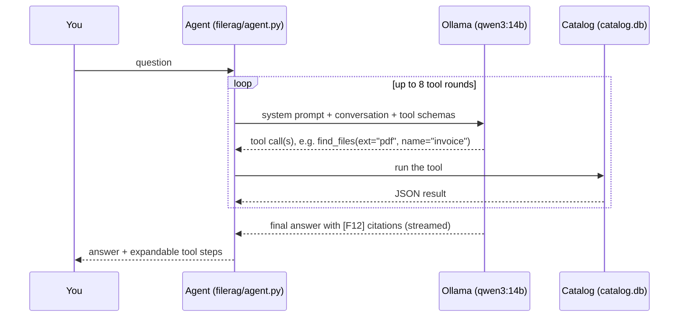

# The agent

The chat agent is a local LLM (default `qwen3:14b`, served by Ollama) that answers questions about your files by
calling **tools** over the catalog. It never sees your disk directly: everything it knows comes from tool results,
and it is instructed to cite every file it mentions.

## How an answer is produced

The system prompt is rebuilt for every call and contains: the size of the catalog per category, the list of mapped
folders, today's date, the rules below, attached notes, and the list of files already touched in this chat.

Rules the model is given (summary):

- Ground every claim in tool results; never invent names, paths, sizes or contents.
- Cite files as `[F12]`, with a line or page when known: `[F12 L40]`, `[F12 p.3]`.
- Pick the right tool (see below), combine tools, and rephrase or relax filters before concluding that nothing
  exists.
- Present more than three files as a table; duplicates as one row per set.
- **This app never deletes or moves files**: for clean-up, list candidates and let the user decide.

## Tools

| Tool | Purpose | Main arguments |
|---|---|---|
| `find_files` | Find files by metadata | all [filters](search-and-filters.md#filters), `sort`, `order`, `limit` (≤100) |
| `search_content` | Hybrid search inside readable files and archive listings | `query`, `file`, filters, `limit` (≤25 passages) |
| `file_stats` | Counts and sizes grouped by `ext`, `category`, `folder`, `root`, `year`, `month`, `content` | `group_by`, filters, `sort`, `limit` |
| `folder_sizes` | Sub-folders with recursive size and file count | `path` (optional), filters, `limit` |
| `find_duplicates` | Sets of identical files, most reclaimable space first | filters, `sort` (`wasted` / `copies` / `size`), `limit` |
| `cleanup_report` | Space that could be freed, by kind | none |
| `file_info` | Everything about one file: path, size, dates, type, content status, outline, identical copies | `file` (ref, path or name) |
| `read_file` | Read a file's text in order from a line, page or chunk | `file`, `line`, `page`, `from_chunk`, `chunks` |

Tool results are JSON. File rows are compacted to `ref, name, folder, ext, size, modified` (plus pixel size / date
taken for images, and a flag when the content is readable) to save context.

Every tool call is shown in the UI as a step above the answer; expand it to see exactly what was asked and
returned. In the CLI, `-v` prints the results.

## Citations

| Citation | Means | Click opens |
|---|---|---|
| `[F12]` | file 12 | the file panel |
| `[F12 L40]` | file 12, line 40 | the source view, scrolled to and highlighting line 40 |
| `[F12 p.3]` | file 12, page 3 | the file's text at page 3 |

File refs are stable: `F12` is the catalog id of that file and stays the same across rescans as long as the file
exists at the same path. `python -m filerag show F12` and `GET /api/v1/files/F12` look one up.

## Getting good answers

- **Name the kind of thing**: *"PDF invoices from 2024"* lets the model use `ext` and date filters instead of a vague
  content search.
- **Say where**: *"in Projects\website"* becomes a `folder` filter.
- **Ask for numbers**: *"how much space do videos take, per folder"* → `file_stats`.
- **Follow up**: *"open the second one"*, *"what does that config set for the port"*: the agent remembers the
  files from earlier turns.
- **Content questions need content**: the model can only read files whose text was indexed (see
  [what is searchable](search-and-filters.md#content-search)).
- Check important answers by clicking the citation. Local models can misread or overgeneralise.

### Answer length

*Settings → Appearance → Answer length* (or `FILERAG_ANSWER_LENGTH`):

| Level | Behaviour | Token cap per model call |
|---|---|---|
| Concise | One-sentence answer plus at most 5 bullets | 400 |
| Normal (default) | ~300 words or a table plus a few bullets | 1200 |
| Detailed | Thorough when useful | none |

Writing tokens is the slow part on consumer GPUs, so shorter is noticeably faster.

### Reasoning mode

*Settings → Model → Reasoning mode* (`FILERAG_THINK=1`) lets qwen3-style models think before answering. Better on
multi-step questions, much slower. The thinking text is shown collapsed above the answer.

## Context and long chats

The model's context window (default 32k tokens) must hold the system prompt, tool schemas, conversation and the
answer. Two mechanisms keep long chats working ([`filerag/context.py`](../filerag/context.py)):

1. **Remembered files**: every file touched in the chat (ref, name, folder, what was done with it) is listed in the
   system prompt, so *"that file"* still resolves after old turns are trimmed.
2. **Compaction**: when the conversation no longer fits, old tool results are reduced to one-line digests
   (`[compacted] 12 passages: F3, F9, …`), then the oldest turns are dropped, keeping their questions as a topic
   list. The current question is never trimmed.

The **context meter** under the input box shows how full the context is. Near the limit a banner offers
**Summarize & continue**: the chat is summarised into a note, and a new chat starts with that note attached.

## Notes as memory

A note attached to a chat is added to the system prompt, and file refs listed in it (`- [F12] main config`) are
added to the remembered files. Use notes for background the model should always have: *"Work projects are under
D:\Work; F120 is the production config"*.

## Changing the model

*Settings → Model* or the model chip under the input box lists installed Ollama models and can download new ones
(with progress). Only models that support **tool calling** work; browse them at
[ollama.com/search?c=tools](https://ollama.com/search?c=tools). The change applies to the next question.

## Limits

- At most 8 tool rounds per answer (`FILERAG_MAX_TOOL_ROUNDS`, 1–20).
- The agent cannot open files that are not mapped, cannot run programs, and cannot change anything on disk.
- It cannot see inside images, audio or video, only their metadata.
- Smaller models follow the citation and table rules less reliably.
