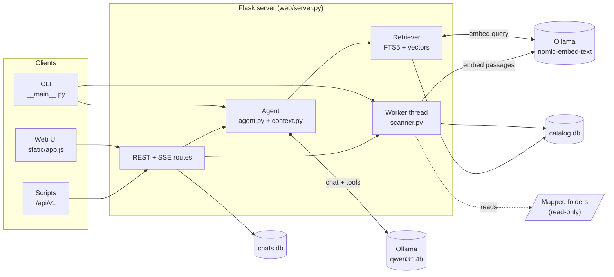
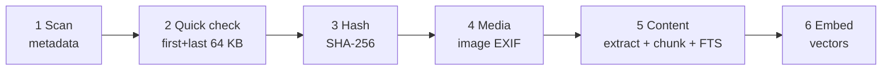
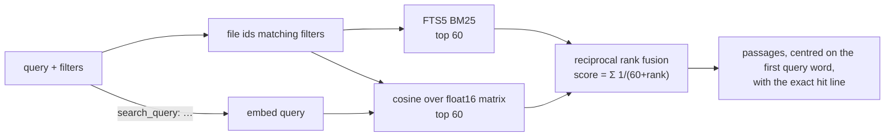

# Architecture

Files Explorer is a single Python process: a Flask web server, one background worker thread for disk and GPU work,
and an agent that calls a local LLM through Ollama. All state is in SQLite files.



## Modules

| Module | Responsibility |
|---|---|
| `config.py` | Every setting, read from `FILERAG_*` environment variables |
| `settings.py` | UI-adjustable subset, persisted in `settings.json` and applied onto `config` at runtime |
| `categories.py` | Extension → category map, category aliases |
| `scanner.py` | Folder walking, the indexing phases, the background `Worker` |
| `extract.py` | Text extraction per format, archive listings, chunking with line / page numbers |
| `catalog.py` | `catalog.db` schema and migrations, filters, queries (find, group, duplicates, folders, cleanup, read) |
| `index.py` | In-memory float16 vector matrix, cosine search |
| `retriever.py` | Hybrid search: FTS5 + vectors, reciprocal rank fusion |
| `agent.py` | Tool schemas, system prompt, tool-calling loop, streaming events |
| `context.py` | Token budgeting, compaction of old tool results, remembered files |
| `notes.py` | Chat summaries, notes block for the system prompt, Markdown export |
| `llm.py`, `models.py` | Ollama client, model list / pull / delete |
| `web/server.py` | Flask app, UI endpoints, SSE chat streaming, startup resume |
| `web/api_v1.py` | Public API blueprint with API-key auth |
| `web/static/` | Single-page UI (vanilla JS, no build step) |

## Indexing pipeline

All disk and GPU work runs on **one worker thread** with a job queue, so a scan and an embedding job never compete
for the disk or the GPU. A job (`scan` of one folder, or `index` of whatever is pending) runs these phases in
order; each phase works from what the database says is still missing, so any phase can be stopped and resumed.



### 1. Scan

`scan_root` walks the folder with `os.scandir`, skipping excluded folder names, hidden entries (dot-names and, on
Windows, folders with the hidden+system attributes), Office lock files (`~$…`), and symbolic links (they are not
followed). For every file it records path,
name, extension, category, size, modification and creation time. Files are compared to the catalog:

- **new** → inserted; content state `pending` if readable, `none` if not, `skipped` if too large.
- **changed** (size or mtime differs) → updated; hash, quick hash and image details are cleared so later phases
  redo them; content goes back to `pending`.
- **unchanged** → only the `seen` timestamp is updated (content state is re-evaluated when settings changed).
- **gone** (not seen in this scan) → deleted with its passages and vectors.

Writes are batched. Thousands of files per second on an SSD.

### 2–3. Duplicate detection

Identical files must have the same size, so only files whose size occurs more than once are candidates.

1. **Quick check**: candidates larger than 1 MB get a SHA-256 of their first and last 64 KB (`quick` column).
2. Candidates whose `(size, quick)` pair is unique cannot have a copy; they are marked `distinct` and never read
   in full.
3. Everything else (small candidates, and big ones whose quick check matches another file) is hashed in full
   (`sha256` column).
4. When a new file later matches the quick hash of a file marked `distinct`, that file's mark is cleared so it gets
   a full hash too.

`distinct` and `unreadable` are markers, not hashes (only 64-character values are treated as hashes). Duplicate
sets are then a simple `GROUP BY sha256 HAVING count(*) > 1`.

The full hash is reused by the content phase: a file whose hash matches an already indexed file copies that file's
passages and vectors instead of being read and embedded again.

### 4. Media

Images (`jpg jpeg jfif png gif bmp tif tiff webp ico`) are opened with Pillow to read the pixel size and EXIF:
date taken (`DateTimeOriginal`, falling back to `DateTime`), camera make and model, and whether GPS data exists.
Pixel size and date taken go into columns (filterable and sortable); the rest into the file's `meta` JSON.

### 5. Content

`extract.py` turns a file into pages of text:

| Format | Extractor | Position kept |
|---|---|---|
| Text, Markdown, code, config, logs | decode (UTF-8, UTF-16 with BOM, then cp1252 / latin-1) | line numbers |
| PDF | pypdf | page numbers, title, metadata |
| Word `.docx` | python-docx | headings as sections, tables |
| PowerPoint `.pptx` | python-pptx | one page per slide, notes |
| Excel `.xlsx` | openpyxl | one page per sheet |
| CSV / TSV, JSON, Jupyter, HTML, `.eml` | built-in | |
| `.zip`-family and `.tar` archives | `zipfile` / `tarfile` | one line per entry |
| Unknown extensions | read as text if the first 8 KB look like text | line numbers |

The text is split into passages of ~1500 characters with 200 characters of overlap, preferring paragraph and line
boundaries, each with its starting line (or page) and the nearest heading. Passages go into the `chunks` table;
triggers keep the `chunks_fts` FTS5 index (porter stemmer, unicode61, diacritics removed) in sync.

### 6. Embed

Passages without a vector are sent to `nomic-embed-text` in batches of 32, prefixed with
`search_document: ` and the file name and relative path (so a passage knows which file it belongs to). Only the
first 100 passages of each file are embedded. Vectors are stored as float16 blobs. The server reloads the in-memory
matrix as batches finish, so semantic search improves while embedding is still running.

### Startup resume

When the web server starts it queues: any folder left in `queued` or `scanning`, and one `index` job if anything
is pending (contents, image details, unhashed same-size files, missing vectors).

## Catalog schema

```sql
roots   (id, path UNIQUE, added, last_scan, status, error)
files   (id, root_id, path UNIQUE, dir, rel, name, ext, category, size, mtime, ctime, seen,
         content,            -- none | pending | ready | error | skipped
         kind, title, pages, lines, chars, chunks, indexed_mtime, indexed_size,
         sha256, quick,      -- duplicate detection (see above)
         width, height, taken, media,   -- image details
         error, warning, meta)          -- meta: JSON of format metadata
chunks  (id, file_id, seq, page, line, heading, text)
chunks_fts  FTS5(text, heading) over chunks
vectors (chunk_id, emb BLOB float16)
meta    (k, v)               -- e.g. the embedding model the vectors were made with
```

Indexes on `root_id`, `ext`, `category`, `dir`, `mtime`, `size`, `content`, `sha256`, `taken`. Columns added by later
versions are listed in `NEW_COLUMNS` and added with `ALTER TABLE` when an older catalog is opened.

File refs: `F<id>` is `files.id`, so it is stable as long as the file stays at the same path.

### Folder sizes

`folders()` aggregates `files.dir` with `LIKE 'path\%'` prefix sums, so every folder's total includes all its
descendants, computed on demand from the indexed `dir` column.

## Retrieval



The keyword query is built from the words of the question minus stop-words, each quoted and OR-ed together; BM25
weights matches in section headings twice as high as in the text. Filters are
applied before ranking (both retrievers only consider passages of matching files). Returned passages are trimmed
around the first matching word and their line number is adjusted to the line of the hit, so `[F12 L40]` points at
the match rather than the start of the passage.

## Agent loop

1. Build the view: system prompt (catalog overview, mapped folders, rules, notes, remembered files) + the
   conversation, compacted to fit `NUM_CTX − CONTEXT_RESERVE` tokens.
2. Call Ollama `chat` with the tool schemas, streaming. Tokens and thinking are forwarded as events.
3. If the model returns tool calls, run each (under a lock, since one SQLite connection is shared), append the
   JSON result, and go to 1. At most `MAX_TOOL_ROUNDS` rounds.
4. Otherwise the streamed text is the answer. Stats (tokens, speed, time) are attached.

Tool results are compact JSON (file rows reduced to the fields the model needs). `context.py` replaces old tool
results with one-line digests when the context fills, then drops the oldest turns, and keeps a list of every file
touched so references survive.

## Web server

- Flask with `threaded=True`; long operations are server-sent event streams (`text/event-stream`) fed by a
  `queue.Queue` from a worker thread: chat answers, model downloads.
- The UI polls `/api/status` (Ollama, GPU via `nvidia-smi`, worker progress), faster while a job runs.
- One `Agent` per open chat is kept in memory; chats are saved to `chats.db` after every answer.
- `/api/v1` is a separate blueprint with a `before_request` API-key check.

## Design rules

- **Read-only on user files.** No code path deletes, moves, renames or writes a mapped file. Clean-up and
  duplicate features only report.
- **Local only.** The only network peer is the configured Ollama server.
- **Resumable.** Every phase derives its work list from the database, so stopping and restarting is always safe.
- **Cheap first.** Metadata is available within seconds; expensive work (reading, hashing, embedding) only touches
  what needs it.
