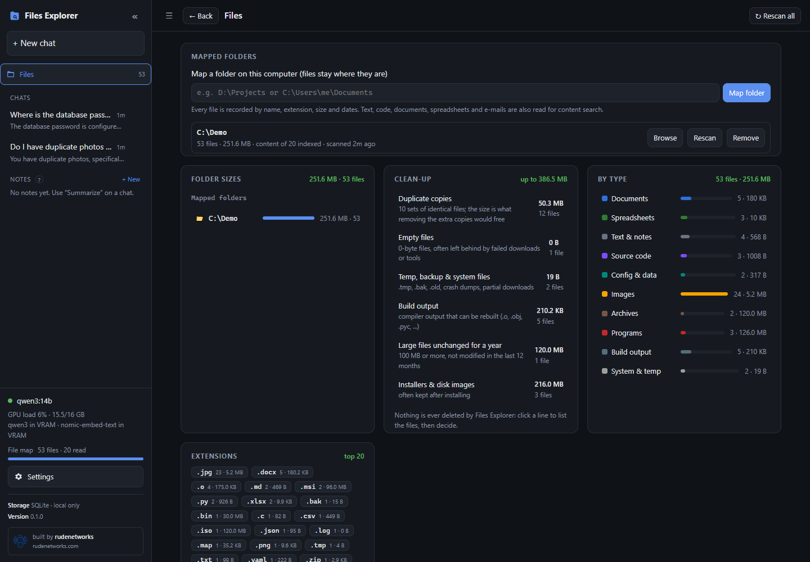
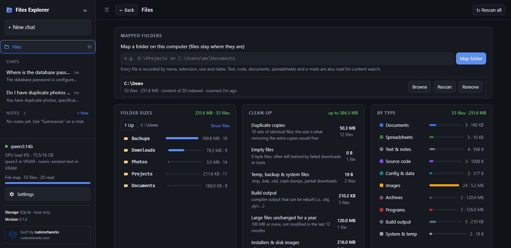
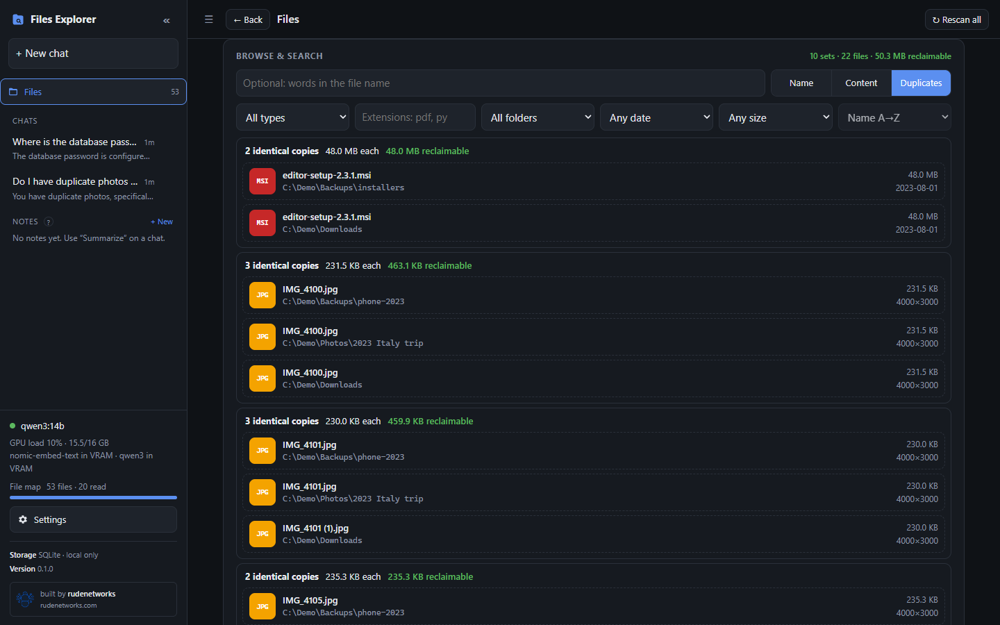
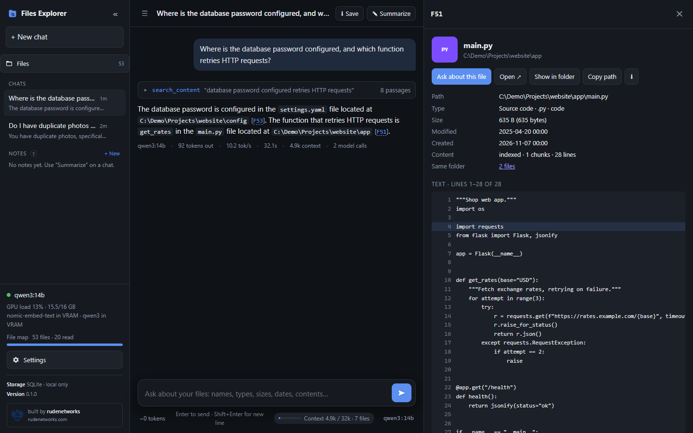

# User guide

This guide walks through the web app at **http://127.0.0.1:8200**. Everything here can also be done from the
[CLI](cli.md) or the [HTTP API](api.md).

- [The layout](#the-layout)
- [Mapping folders](#mapping-folders)
- [The Files page](#the-files-page)
  - [Folder sizes](#folder-sizes) · [Clean-up](#clean-up) · [By type and Extensions](#by-type-and-extensions) ·
    [Browse & search](#browse--search) · [Duplicates](#duplicates)
- [The file panel](#the-file-panel)
- [Chatting with the agent](#chatting-with-the-agent)
- [Notes](#notes)
- [Settings](#settings)
- [Keyboard shortcuts](#keyboard-shortcuts)

## The layout

The **sidebar** on the left holds:

- **+ New chat** and the list of saved **Chats**.
- **Files**: opens the Files page; the number next to it is how many files are mapped.
- **Notes**: summaries of past chats and your own notes.
- The **status box**: whether Ollama is reachable and which model is loaded, GPU name and VRAM use, and the
  **File map** progress bar. While a background job runs, the line under the bar says what it is doing (for
  example *Reading contents 1,204 / 9,880 · report.pdf*).
- **Settings**, version, and the rudenetworks link.

On narrow screens the sidebar folds away behind the ☰ button.

## Mapping folders

1. Open **Files**.
2. Type or paste a folder path under **Mapped folders** (for example `D:\Projects` or `/home/me/Documents`) and
   click **Map folder**.

The folder is scanned in the background. You can keep working: results appear as each phase finishes.

| Phase | What happens | Speed (typical SSD) |
|---|---|---|
| **Scanning** | Every file's name, extension, category, size and dates are recorded | thousands of files / s |
| **Quick-checking same-size files** | Files over 1 MB that share their size with another file: first and last 64 KB are compared | fast |
| **Comparing same-size files** | Possible duplicates are hashed in full (SHA-256) | disk speed |
| **Reading image details** | Pixel size, date taken, camera (EXIF) | hundreds / s |
| **Reading contents** | Text of documents, code, notes, spreadsheets, e-mails, archive listings; split into passages and indexed | 10–50 files / s |
| **Embedding** | Passages are turned into vectors on the GPU for meaning-based search | depends on GPU |

Each mapped folder shows its file count, size, how many files have readable content, the last scan time and a
status. Per folder you can:

- **Browse**: list its files in *Browse & search*.
- **Rescan**: picks up new, changed and deleted files. Unchanged files (same size and modification time) are never
  read again, so rescans are fast.
- **Remove**: forgets the folder and everything learned about it. **Nothing is deleted on disk.**

**↻ Rescan all** at the top rescans every folder. **Stop** in the progress box stops the current job; the next
scan or app start continues where it stopped.

Mapping a folder that is inside an already mapped folder does nothing (it is already covered). Folders named in
*Settings → Mapping → Folders to skip* (`.git`, `node_modules`, `.venv`, …) and hidden folders are not entered.

> Files Explorer has no file watcher: rescan (or run `python -m filerag scan` on a schedule) to pick up changes.

## The Files page

### Folder sizes

Lists the mapped folders, then lets you drill down: click a folder to see its sub-folders, each with its **total
size including everything below it**, its file count and the newest modification date, largest first. **↑ Up**
goes back one level; **Show files** opens the current folder in *Browse & search*.

### Clean-up

A report of space that could be freed:

| Line | What it counts |
|---|---|
| **Duplicate copies** | All copies but one of every set of identical files |
| **Empty files** | 0-byte files |
| **Temp, backup & system files** | `.tmp`, `.bak`, `.old`, `.swp`, crash dumps, partial downloads, … |
| **Build output** | `.o`, `.obj`, `.pyc`, `.pdb`, `.class`, … (can be rebuilt) |
| **Large files unchanged for a year** | 100 MB or more, not modified in the last 12 months |
| **Installers & disk images** | `.msi`, `.iso`, `.img`, `.dmg`, `.pkg`, `.deb`, `.rpm`, `.appimage` |

Click a line to list those files in *Browse & search*. **Files Explorer never deletes, moves or changes files**:
it only shows you candidates. Delete what you choose with your file manager (*Show in folder* in the file panel
takes you there).

### By type and Extensions

**By type** shows the 17 categories (Documents, Spreadsheets, Presentations, Text & notes, Source code,
Config & data, E-mail, Images, Audio, Video, Archives, Programs, Databases, Build output, Fonts, 3D & design,
System & temp, plus Other) with file count and size. **Extensions** is a cloud of the most common extensions.
Click any of them to filter the browser.

### Browse & search

The browser has three modes, switched with **Name / Content / Duplicates**:

- **Name**: matches file names. Several words must all appear (`invoice 2024`); a glob matches the whole name
  (`*.tar.gz`, `report_??.xlsx`).
- **Content**: searches *inside* readable files and archive listings. Results are grouped per file with the best
  matching passage and its line or page. Combines keyword and meaning-based search
  ([details](search-and-filters.md#content-search)).
- **Duplicates**: sets of identical files (see below).

Filters below the search box: type, extensions (`pdf, docx`), mapped folder, date (last 24 h / 7 days / 30 days /
year), size, and sort order. Filters set by clicking elsewhere (a category, an extension, a clean-up line, a folder)
appear as removable chips. All filter syntaxes are in [Search & filters](search-and-filters.md).

Click a file to open the [file panel](#the-file-panel). **Load more** pages through long lists.

### Duplicates

Each card is one set of identical files (same SHA-256): number of copies, size of each, and **reclaimable** space
(what removing all but one copy would free), followed by every copy's location. Sets are sorted by reclaimable
space. The filters apply, so you can look for duplicate photos only (type *Images*) or duplicates inside one
folder.

While the comparison is still running, the header says how many files are still being compared.

How it is done without reading the whole disk: only files that share their exact size with another file can be
identical. Files over 1 MB get a quick check of their first and last 64 KB first; only files that still match
another are read in full. See [Architecture](architecture.md#duplicate-detection).

## The file panel

Clicking a file (in the browser, a citation in a chat, or a folder list) opens a panel on the right with:

- **Details**: name, full path, size, type, extension, modified / created dates, content status (indexed, not
  readable, too large, error), pages / lines, and for images the pixel size, date taken and camera.
- **Identical copies**: other files with exactly the same content, if any.
- **Preview**: images, audio and video play inline; text and code are shown with **line numbers** (a citation like
  `[F12 L40]` scrolls to and highlights line 40); PDFs and Office files show their extracted text by page;
  archives show their file list.
- **Same folder**: a link that lists the other files in the file's folder.
- **Outline**: section headings of documents (click to jump).
- **Actions**:
  - **Ask about this file**: starts a chat question about it.
  - **Open ↗**: opens the file in a new browser tab (or downloads it if the browser cannot show it).
  - **Show in folder**: opens Explorer / Finder / the file manager at the file. Only works when the browser is on
    the same computer as the server.
  - **Copy path**.
  - **⬇**: download.

Esc closes the panel.

## Chatting with the agent

Type a question in the chat box. The model (running in Ollama on your GPU) answers by calling tools that search
the catalog, and every file it mentions is cited as `[F12]`, `[F12 L40]` (line 40) or `[F12 p.3]` (page 3). Click a
citation to open the file panel at that spot.

Good questions:

- *What kinds of files do I have, and which take the most space?*
- *Find the 10 largest files modified this year.*
- *Where are my 2024 invoices?*
- *Which config file sets the database password?*
- *Which Python files import requests?*
- *Do I have duplicate photos? How much space would removing them free?*
- *Which zip contains setup.py?*
- *Photos taken in summer 2023 larger than 4000 px.*
- *How could I free up space in D:\Downloads?*

Each tool call appears as a collapsible step above the answer (expand it to see the arguments and results). The
stop button (■) interrupts an answer.

Below the input box: an estimate of the tokens you typed, the **context meter** (how full the model's context is),
and the model chip (click to switch model). When the context gets nearly full a banner offers **Summarize &
continue** (writes a summary note and continues in a fresh chat with it attached), **Save chat** or **Reset**.

Chat actions in the header: **⬇ Save** downloads the chat as Markdown; **✎ Summarize** writes a summary note.

More about how the agent works, its tools and limits: [The agent](agent.md).

## Notes

Notes are short Markdown documents in the sidebar. They come from **Summarize** on a chat, or from **+ New**
(write your own). A note can be **attached to a chat**: its text is given to the model as background, and the
files it cites are remembered. Use notes to carry findings from one chat into another (for example *"the
project's configs are in F120, F133"*). Notes can be edited, exported as Markdown and deleted.

## Settings

| Section | Settings |
|---|---|
| **Appearance** | Theme (System / Light / Dark / Hack), text size, answer length (Concise / Normal / Detailed), Enter sends message, expand tool steps, show token stats |
| **Mapping** | Read file contents, Semantic search, Detect text in unknown extensions, Find duplicates, Read image details, List files inside archives, Skip hidden files and folders, Largest file to read (MB), Folders to skip |
| **Model** | Chat model, download a model from Ollama (with progress), installed models (delete), temperature, context window (8k–32k), reasoning mode, max tool calls per answer |
| **API** | Enable API access, create / revoke API keys, endpoint list and examples |

Appearance preferences are stored in your browser. All other settings are saved to `settings.json` and apply
immediately (no restart). Turning on *Semantic search*, *Find duplicates* or *Read image details* starts a
background job that fills in what is missing. Every setting is described in [Configuration](configuration.md).

## Keyboard shortcuts

| Key | Action |
|---|---|
| Enter | Send (or new line, if *Enter sends message* is off) |
| Shift+Enter | New line |
| Ctrl+Enter | Send (when *Enter sends message* is off) |
| Esc | Close the file panel, or go back from Files / Settings to the chat |
